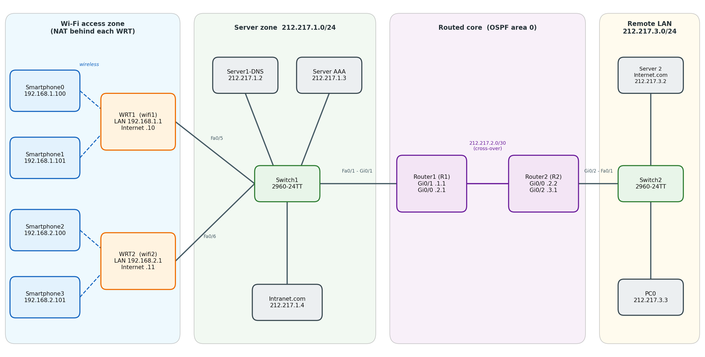

# Wi-Fi Security Models: Open, WPA2-PSK and WPA2 with RADIUS

One routed wireless network built **three times** and compared across three security models: an open network, WPA2-PSK, and WPA2 with RADIUS (AAA). Everything is built in **Cisco Packet Tracer**: two WRT300N access networks with DHCP, DNS and NAT, a RADIUS server, and an OSPF core between two Cisco 2911 routers.

**Result:** only the RADIUS model identifies each user and lets you remove one access without changing a shared password.



| | |
|---|---|
| **Author** | Ali Harti |
| **Tool** | Cisco Packet Tracer, source file `3CI_Securite_WRT300N` |
| **Platform** | 2 x WRT300N, 2 x Cisco 2911, 2 x Catalyst 2960-24TT, 4 servers, 1 PC, 4 smartphones |
| **Report** | [`docs/`](docs/) (French, dated 14 October 2026) |
| **Status** | Finished. 13 of 13 validation checks pass |

## Real-World Context: Why This Project Exists

### 1. The Real-World Need
Wireless Local Area Networks (WLANs) transmit radio signals beyond physical walls, property lines, and office doors. Because physical security cannot prevent an attacker from listening to or transmitting Wi-Fi frames, authentication and link-layer encryption are the organization's frontline defenses:
- **The Cleartext Vulnerability of Open Networks:** In unencrypted networks, all frames travel in the clear. Any passive listener within signal range can intercept unencrypted sessions, sniff sensitive cookies, harvest credentials, or execute rogue AP (evil twin) attacks.
- **The Operational Flaw of WPA2-Personal (PSK):** While WPA2-PSK encrypts over-the-air traffic with AES-CCMP, it relies on a single shared passphrase for all devices. When an employee departs, a contractor leaves, or a device is lost, administrators face a logistically impossible task: reconfiguring the passphrase on dozens or hundreds of client devices. In reality, organizations almost never change it, leaving their internal network permanently vulnerable to unauthorized former users. Furthermore, PSK provides zero audit trails or individual accountability.
- **The Enterprise Requirement (802.1X / RADIUS):** Corporate and institutional environments mandate centralized **Authentication, Authorization, and Accounting (AAA)**. With WPA2-Enterprise / RADIUS, every user logs in with unique credentials. Revocation is instantaneous at the central directory without touching access points or interrupting other users.

### 2. Why We Built This Lab
The objective was to deploy an identical multi-zone routed network in Cisco Packet Tracer and systematically evaluate all three wireless security models—Open, WPA2-PSK, and WPA2-Enterprise (RADIUS)—under identical conditions:
- To demonstrate why WPA2-PSK fails the operational requirements of an organization with multiple users.
- To validate the end-to-end authentication exchange between wireless clients, access points acting as RADIUS Network Access Servers (NAS), and the central AAA server across routed boundaries.
- To prove credential isolation: confirming that invalid credentials drop unauthorized sessions immediately, while legitimate authenticated users receive dynamic IP leases and reach both internal intranet and external internet services.

### 3. What Was Engineered
- **Multi-Zone Wireless Access:** Two Cisco WRT300N wireless routers delivering dual distinct Wi-Fi cells (`192.168.1.0/24` and `192.168.2.0/24`) with localized DHCP pools and NAT.
- **Routed Core Infrastructure:** Point-to-point OSPF Area 0 core connecting two Cisco 2911 routers, isolating the wireless perimeter from the server farm and remote simulated Internet.
- **Centralized AAA/RADIUS Architecture:** Dedicated AAA server configured with NAS client secrets and individual user authentication credentials.
- **Comprehensive Verification Matrix:** 13 verified test checks validating association, DHCP leasing, DNS resolution, and dual-server HTTP access across all three security configurations.

## The three security models

Same hardware, same smartphones, same routing. Only the Wi-Fi security settings change between scenarios, so a failure in a later scenario points to the security settings, not to routing, DNS or DHCP.

| | Open | WPA2-PSK | WPA2 + RADIUS |
|---|---|---|---|
| Identity checked | None | Knowledge of one shared passphrase | Individual username and password |
| Radio encryption | None | AES | AES |
| Needs a server | No | No | Yes (Server AAA must be reachable) |
| Traceability | None | None (everyone shares the key) | Per user |
| Revoking one user | Not applicable | Change the key on every device | Delete the user on the server |
| Suitable for | Isolated public guest access | Home or very small office | Organisations with many users |
| Main weakness | Open to eavesdropping and abuse | The shared secret can leak | Depends on the AAA server, heavier setup |

**Evidence for each model:**
- **Open:** baseline. If connectivity works here, any later failure comes from the security settings.
- **WPA2-PSK:** a wrong passphrase on Smartphone0 dropped its wireless link while the other three phones stayed connected. After the correct passphrase was restored it reconnected and kept 192.168.1.100.
- **WPA2 + RADIUS:** with valid credentials the phones associated, received 192.168.x.x addresses and loaded both web sites. With a wrong password one phone lost its link and recovered once the correct password was restored.

The wrong-credentials test applies to the two secured models. The open network has no credentials to get wrong.

## Architecture

Four zones, each with its own subnet. Traffic between zones always crosses a router or a NAT boundary.

| Zone | Subnet | Devices | Role |
|---|---|---|---|
| Wi-Fi access | 192.168.1.0/24 (wifi1), 192.168.2.0/24 (wifi2) | WRT1, WRT2, Smartphone0 to 3 | Each WRT is access point, DHCP server and NAT router for its own private network |
| Servers | 212.217.1.0/24 | Switch1, DNS, AAA, Intranet.com, R1 Gi0/1, Internet ports of both WRT | Shared services, and the "outside" network from the WRT point of view |
| Routed core | 212.217.2.0/30 | R1 Gi0/0, R2 Gi0/0 | Point-to-point link, OSPF process 1, area 0 |
| Remote LAN | 212.217.3.0/24 | R2 Gi0/2, Switch2, Internet.com, PC0 | Simulates a remote or Internet side |

| Device | Interface | Address |
|---|---|---|
| R1 | Gi0/1 / Gi0/0 | 212.217.1.1/24 / 212.217.2.1/30 |
| R2 | Gi0/0 / Gi0/2 | 212.217.2.2/30 / 212.217.3.1/24 |
| Server1-DNS / Server AAA / Intranet.com | Fa0 | 212.217.1.2 / .3 / .4 (/24) |
| WRT1 | Internet / LAN | 212.217.1.10/24 / 192.168.1.1/24 (DHCP .100 to .149) |
| WRT2 | Internet / LAN | 212.217.1.11/24 / 192.168.2.1/24 (DHCP .100 to .149) |
| Server 2 Internet.com / PC0 | Fa0 | 212.217.3.2 / 212.217.3.3 (/24) |
| Smartphone0, 1 / 2, 3 | Wireless0 (DHCP) | 192.168.1.100, .101 / 192.168.2.100, .101 |

DNS records on Server1-DNS: `intranet.com` to 212.217.1.4, `internet.com` to 212.217.3.2. Clients all use DNS 212.217.1.2.

### How a request flows

Smartphone0 opens `http://internet.com`: it associates to wifi1 and gets a DHCP lease from WRT1, asks the DNS server (212.217.1.2) through WRT1, which translates its private address to 212.217.1.10 (NAT). It then connects to 212.217.3.2 via R1, which learned 212.217.3.0/24 from R2 through OSPF. R2 delivers it on the remote LAN and the reply travels back the same way.

## RADIUS roles (scenario 3)

| Role | Device | Function |
|---|---|---|
| Supplicant | Smartphone | Presents a username and password |
| Authenticator | WRT1 / WRT2 | Relays the request to the RADIUS server and enforces the decision |
| Authentication server | Server AAA (212.217.1.3) | Checks the credentials and answers accept or reject |

The RADIUS client IP registered on Server AAA is the **Internet address of the WRT** (212.217.1.10 and .11), because that is where the RADIUS requests originate. The shared secret must match on both sides. Credentials used in the lab are not published here (see [Notes](#notes)).

## Validation

13 checks, tested layer by layer. All pass.

| # | Test | Observation |
|---|---|---|
| 1 | Router interfaces | Gi0/0 and Gi0/1 (R1), Gi0/0 and Gi0/2 (R2) up/up |
| 2 | OSPF adjacency | FULL on both routers (R2 is DR, R1 is BDR) |
| 3 | Routing through the core | PC0 pings 212.217.1.2, .3, .4 with TTL 126 (two routers crossed) |
| 4 | Remote server | PC0 to 212.217.3.2: 4 of 4 replies |
| 5 | DNS resolution | `intranet.com` and `internet.com` resolve to 212.217.1.4 and 212.217.3.2 |
| 6 | Web from PC0 | Both sites load |
| 7 | DHCP on the WRTs | Leases .100 and .101 on each WRT, correct gateway, DNS 212.217.1.2 |
| 8 | Smartphone to infrastructure | WRT gateway (TTL 255), 212.217.1.1 (254), 212.217.1.4 (127), 212.217.3.2 and .3.3 (125), names resolve |
| 9 | Web from smartphones | Both sites load in every scenario |
| 10 | Wrong credentials refused | Wrong PSK, then wrong AAA password: wireless link dropped, restored after correction |
| 11 | Smartphones on the same WRT | Ping works |
| 12 | Smartphones on different WRTs | Fails (expected, see NAT) |
| 13 | Wired hosts to smartphones | Fails (expected, see NAT) |

Details, traffic matrix and the troubleshooting log: [`docs/test-plan.md`](docs/test-plan.md).

### NAT behaviour

| Traffic | Result | Reason |
|---|---|---|
| Smartphone to smartphone, same WRT | Works | Same private LAN, no routing needed |
| Smartphone to servers and PC0 | Works | The WRT translates the address, OSPF routes the packet |
| Servers or PC0 to a smartphone | Fails | The private address is not routable and NAT has no entry for an inbound connection |
| Smartphone to smartphone, different WRT | Fails | Each private network hides behind its own NAT, and 192.168.1.0/24 and 192.168.2.0/24 are not advertised in OSPF |

This is the intended behaviour here: the lab is about securing wireless access, not reaching the phones from the wired side.

## Security assessment

**What it does well:** AES encryption in the PSK and RADIUS scenarios, per-user identity in the RADIUS scenario, the two Wi-Fi networks isolated from each other, wired hosts unable to open connections towards the phones, and DNS and AAA kept in a separate server zone.

**What it lacks (documented, not hidden):**

| Gap | Impact |
|---|---|
| NAT is not a firewall | Protection from inbound connections is a side effect of translation, not a defined policy |
| Phones can reach every server | Including the AAA and DNS servers: a device that joins the Wi-Fi can probe them |
| Flat server subnet | No access control between servers |
| HTTP in clear text | Readable by anyone who can capture it |
| Weak lab credentials, legacy RADIUS port 1645 | Production should use strong unique secrets and the standard port 1812 |
| Single path, single DNS, single AAA, one RADIUS user | No redundancy, accounting not examined |

Recommended next steps (not implemented): an ACL on R1 limiting phones to DNS and HTTP, VLANs for the servers, HTTPS and a firewall, WPA2-Enterprise with certificates (EAP-TLS) and accounting, strong rotated secrets, and a second router with HSRP and a second RADIUS server.

## Repository layout

```
.
├── README.md
├── LICENSE
├── .gitignore
├── configs/
│   ├── R1.txt                        # Cisco 2911: interfaces, OSPF
│   └── R2.txt
├── docs/
│   ├── Architecture_WiFi_securisee_sur_coeur_route.pdf   # full report (French)
│   ├── configuration-summary.md                          # WRT, servers, DNS, the three Wi-Fi scenarios
│   └── test-plan.md                                      # 13 checks, NAT matrix, troubleshooting log
└── images/
    └── topology.png
```

## Rebuild order

1. Place and cable all devices (all straight-through except the R1 to R2 crossover), check that link lights are green
2. Configure R1 and R2 ([`configs/`](configs/)), check `show ip ospf neighbor` shows FULL
3. Static IPs on the three servers, Internet.com and PC0, ping across the routers from PC0
4. DNS service On with the two A records, edit both `index.html` pages, test names and pages from PC0
5. On each WRT: Internet = Static, LAN address, DHCP start at .100, Static DNS 1, save
6. SSIDs `wifi1` and `wifi2` on the WRTs and phones, renew DHCP on the phones
7. Run the ping series and open both sites from one phone per WRT (open Wi-Fi), save the file
8. Switch to WPA2-PSK, test including a wrong passphrase, save the file
9. Configure Server AAA and switch to WPA2 with RADIUS, test including a wrong password, save the file

## Lessons learned

- Build and test by layers: cabling, addressing, routing, services, Wi-Fi, then security
- Start with the open network: it proves the whole path before security is added
- Always test the negative case (wrong password). A dashed wireless link alone does not prove that authentication is enforced
- Keep a separate copy of the file before each scenario (for example open, psk and aaa versions)
- Many apparent failures come from one wrong field: a service left off, a typo in a DNS record, a DHCP pool starting on the router address

## Limits

Packet Tracer does not model radio interference, signal strength or real traffic load, so performance observations are qualitative. There is a single path between zones with single DNS and AAA servers, only one RADIUS user exists, and accounting records were not examined. The side sketch on the right of the original whiteboard is out of scope.

## Notes

- **Lab credentials are not published.** The Wi-Fi passphrase, RADIUS shared secret and RADIUS user password used in the lab appear as `<PSK>`, `<RADIUS_SECRET>` and `<USER_PASSWORD>` in this repository. Use your own values when rebuilding, and never reuse them outside a lab.
- The Packet Tracer source file is not included.
- Only R1 and R2 have a text config. The WRT300N, server and smartphone settings are GUI parameters, listed in [`docs/configuration-summary.md`](docs/configuration-summary.md).
- The diagram labels are in French, as in the report.

## Author

Ali Harti.
